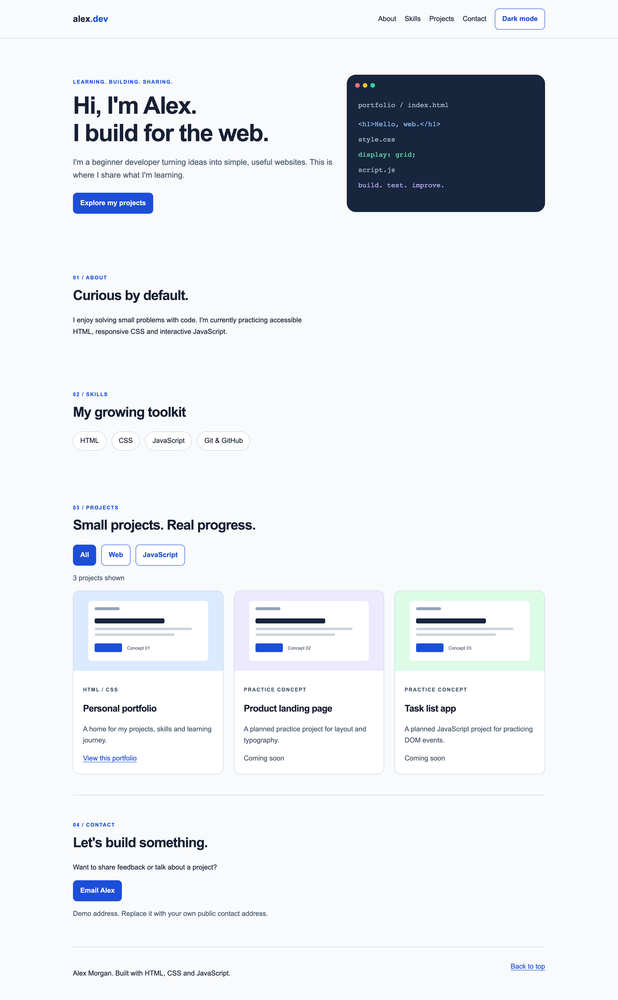
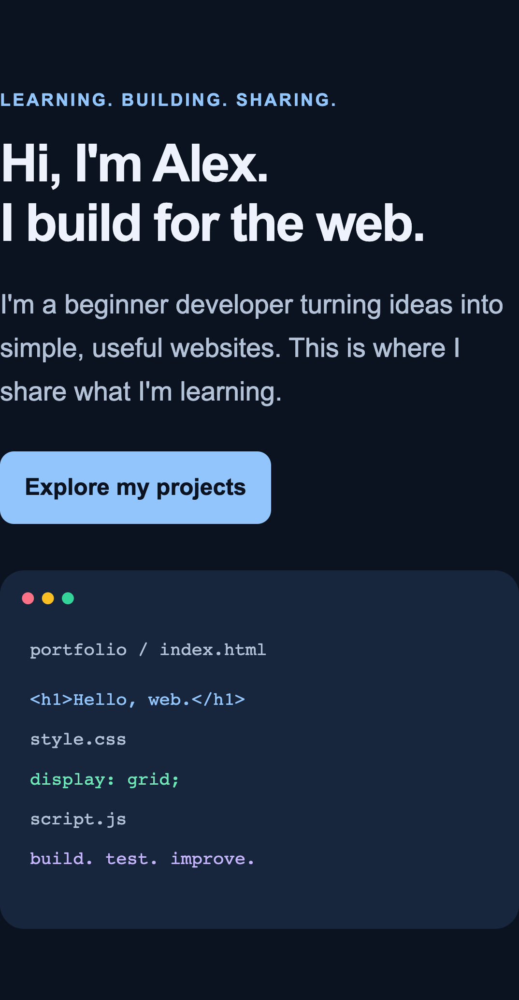
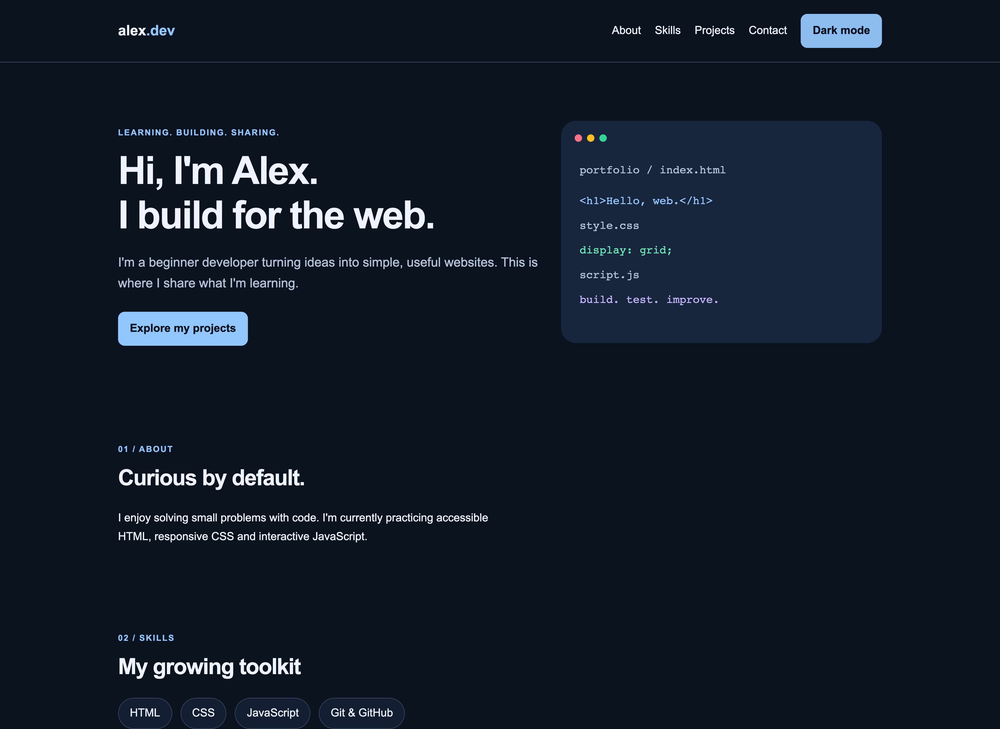

**DevFoundry**

# Build & Deploy Your First Website

**From Zero to a Live Website with HTML, CSS & JavaScript**

A free, project-based beginner web-development course. Start with a small starter project, build a responsive personal portfolio, and publish your website with GitHub Pages. No previous programming experience is required.

DevFoundry's aim is **free and open-source developer education**: learn, build, experiment, contribute and share. **Licensing is pending approval.** This prepared repository does not yet grant an open-source or Creative Commons license. See [LICENSE](LICENSE) before redistributing or reusing its contents.

## Start the course

**[Read the complete 55-page workbook](course/DevFoundry-Build-and-Deploy-Your-First-Website.pdf)**

**Begin with [01-starter-files](01-starter-files/), not the completed solution.**

1. On GitHub, choose **Code → Download ZIP**, then extract it. A repository is the project's files and their version history. If you already use Git, you can clone the repository using its **Code** menu instead.
2. Open the workbook above. It is the full course and the authority for lesson order and exercises.
3. Copy `01-starter-files` into a separate location outside this repository.
4. Rename the copy `devfoundry-portfolio` and open that folder in Visual Studio Code.
5. Follow Modules 0–8, saving and checking each change in your browser.
6. Use checkpoints to compare files when you need help, then return to your own work.
7. In Module 6, deploy **your portfolio folder** from your own repository and verify a live update.

[Detailed setup](docs/getting-started.md) · [Challenges](challenges/README.md) · [Troubleshooting](docs/troubleshooting.md)

## Course preview

Desktop preview of the supplied final reference:

Mobile layout and dark mode

The name Alex Morgan and the email address in these examples are demo content. Two project cards are clearly labelled planned concepts. Replace them with your own honest content before publishing.

## What you will build

One responsive personal developer portfolio containing navigation, a hero, About, Skills, Projects, Contact and a footer. You will add a light/dark theme, mobile menu and project filters, while keeping keyboard focus visible and respecting reduced-motion preferences.

## What you will learn

| Topic | Skills |
| --- | --- |
| HTML | Semantic structure, headings, links, images and sections |
| CSS | Styling, box model, Flexbox and Grid |
| Responsive design | Fluid layouts, breakpoints and media queries |
| JavaScript | DOM, events, state and interactions |
| Git | Repositories, staging, commits and history |
| GitHub | Remote repositories and project sharing |
| Deployment | Publishing a static website using GitHub Pages |
| Accessibility | Keyboard focus, semantic controls and reduced motion |

You need a computer, an editor, a modern browser, Git and a GitHub account. Setup and publishing need internet access. Guided instruction is planned for about 2–3 hours; allow extra time for typing, debugging and the final project.

## Course curriculum

0. Getting Started
1. HTML — Build the Structure
2. CSS — Make It Look Good
3. Responsive Design
4. JavaScript — Make It Interactive
5. Git and GitHub
6. Deploy Your Website
7. Final Project
8. Where to Go Next

The workbook includes the full lessons, projects, code examples, troubleshooting, references, final-project rubric and checklist. [Course and checkpoint map](docs/course-map.md).

## Checkpoints

| Folder | Stage | Use after |
| --- | --- | --- |
| [01-starter-files](01-starter-files/) | Your starting point | Module 0 |
| [02-html-complete](02-html-complete/) | Structure completed, no styling | Module 1 / Project 1 |
| [03-css-complete](03-css-complete/) | Desktop design; narrow-screen overflow is intentional | Module 2 / Project 2 |
| [04-responsive-complete](04-responsive-complete/) | Responsive layouts, no scripted controls | Module 3 / Project 3 |
| [05-javascript-complete](05-javascript-complete/) | Theme, menu and filtering | Module 4 / Project 4 |
| [06-final-project](06-final-project/) | Finished reference source | Modules 5–7 |

Each folder explains what should work and what is not yet implemented. The final source is static HTML, CSS and JavaScript. It has no dependencies, installation or build step.

## Practice and quick references

- [Challenges and pass criteria](challenges/challenges.md) — try these before opening the answers.
- [HTML cheat sheet](cheatsheets/html-cheatsheet.md), [CSS cheat sheet](cheatsheets/css-cheatsheet.md), [Git cheat sheet](cheatsheets/git-cheatsheet.md).
- [Final-project brief and rubric](challenges/final-project.md), [checklist](challenges/final-checklist.md) and [test log](challenges/test-log.md).
- [Troubleshooting](docs/troubleshooting.md), [official resources](docs/resources.md) and [visual reference directory](visuals/README.md).

## Deploy your portfolio

Follow Module 6 in the workbook. GitHub Pages serves the website files from a selected source. Copy your working portfolio's contents to the root of a separate portfolio repository; `index.html` must be at that selected root. Choose **Settings → Pages → Deploy from a branch → main → / (root)**. Verify the completed deployment and visit the URL GitHub displays.

Assets use relative paths so they can load under a GitHub project-site subpath. [Publishing details and verification](docs/publishing.md).

## Contribute

Typos, broken links, accessible examples, browser fixes and clearer beginner explanations are welcome. Read [CONTRIBUTING.md](CONTRIBUTING.md), the [Code of Conduct](CODE_OF_CONDUCT.md) and [security guidance](SECURITY.md). Licensing must be settled before contributions can be accepted under a shared reuse license.

## Continue learning

After this course, practice deeper JavaScript, APIs, backend development and application development. These are possible future DevFoundry learning paths; no unreleased course is required to finish this one.
